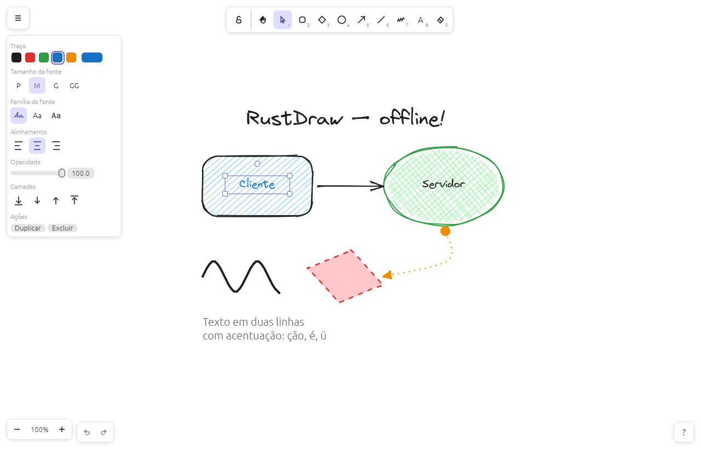

# RustDraw

Editor de diagramas no estilo **Excalidraw**, nativo em Rust e **100% offline** — sem navegador, sem servidor, sem conta. Um único executável (~10 MB) com tudo embutido, inclusive a fonte manuscrita Virgil.



## Recursos

- **Formas**: retângulo, losango, elipse, seta, linha, desenho livre e texto. Duplo clique numa forma escreve dentro dela; como no Excalidraw, o texto quebra na largura da forma e a forma cresce quando ele não cabe
- **Imagens**: cole um print com `Ctrl+V`, arraste PNG/JPG/GIF/WebP para a janela ou use `9` para escolher o arquivo. A imagem fica embutida no `.excalidraw` (campo `files`, igual ao Excalidraw), pode ser movida, redimensionada (mantém a proporção; `Shift` libera), girada e invertida, e sai no PNG e no SVG exportados
- **Visual "desenhado à mão"**: traços irregulares com os mesmos algoritmos do rough.js (o motor do Excalidraw), determinísticos por `seed`
- **Estilos**: cor de traço e fundo, preenchimento (hachura, hachura cruzada, sólido), espessura, tracejado/pontilhado, "desleixo" (arquiteto/artista/cartunista), bordas arredondadas, opacidade, pontas de seta (seta, triângulo, barra, ponto), fonte (à mão/normal/código), tamanho e alinhamento
- **Edição**: seleção por clique ou caixa, mover, redimensionar (inclusive girado), girar (Shift = passos de 15°), editar pontos de linhas, linhas ponto a ponto, duplicar (Ctrl+D ou Alt+arrastar), agrupar, camadas, borracha, desfazer/refazer
- **Menu do botão direito**: como no Excalidraw, um menu para o canvas vazio (colar, copiar como PNG/SVG, selecionar tudo, destravar tudo, grade, modo zen, visualização, estatísticas) e outro para elementos (recortar, copiar, colar, estilos, agrupar, camadas, inverter, duplicar, travar, apagar), com os atalhos ao lado de cada item
- **Tipos de seta** (como no Excalidraw): **afiada** (segmentos retos), **curva** e **cotovelo** (só segmentos horizontais e verticais, com a rota contornando as formas ligadas), escolhidos em "Tipo de seta" no painel
- **Pontos de edição**: numa linha ou seta selecionada, arraste a alça do meio de um segmento (ou dê duplo clique na linha) para criar um ponto; clique nos pontos para selecioná-los (Shift soma), arraste para mover e `Delete` apaga. Em setas em cotovelo, arraste o meio de um segmento para deslocá-lo (ele fica fixo); duplo clique nessa alça devolve o segmento à rota automática
- **Setas que grudam nas formas**: a ponta da seta liga num retângulo, losango, elipse ou texto e acompanha a forma quando ela é movida, redimensionada ou girada. Perto do meio de um lado, encaixa nesse **ponto fixo**; no resto da forma fica **livre**, mirando o centro e parando no contorno. Segure `Ctrl` (`Cmd` no macOS) ao arrastar para não grudar; mover só a seta a solta
- **Frames**: áreas nomeadas (ferramenta `F`) para montar várias telas ou slides num desenho só. O que fica dentro do frame é recortado pela borda dele e anda junto quando ele é movido; arrastar um elemento para dentro ou para fora de um frame o coloca ou tira dele. Duplo clique no nome (ou `Enter` com o frame selecionado) renomeia. Apagar ou duplicar o frame leva o conteúdo junto. Para exportar um frame sozinho, selecione-o e use "Exportar frame…" no botão direito (ou marque "Somente o frame selecionado" na exportação): sai só o conteúdo, do tamanho exato do frame
- **Notas adesivas**: ferramenta `N`. Um clique cola uma nota amarela (sem borda, com sombra e a ponta de baixo dobrada) e já abre para escrever; arrastar escolhe o tamanho. O texto começa em cima à esquerda, quebra na largura da nota e a nota cresce para baixo quando ele não cabe. Trocar a cor de fundo muda também a cor da dobra. No arquivo, a nota é um retângulo com texto dentro, então o Excalidraw abre normalmente (como um retângulo amarelo)
- **Ponteiro laser**: para apresentar (ferramenta `K`, como no Excalidraw). Arrastar deixa um rastro vermelho que some sozinho em um segundo, sem criar elementos nem mexer no histórico. Continua funcionando no modo de visualização se estiver ativo ao entrar nele; `K` de novo volta para a seleção
- **Biblioteca de formas**: guarde formas e grupos para reutilizar (botão **Biblioteca** no canto superior direito, `+` ou "Adicionar à biblioteca" no botão direito). Clique num item para inserir no centro da tela ou arraste para posicionar; `Shift+clique` marca itens para exportar ou remover. O botão direito num item renomeia, edita no canvas (altere, selecione e clique em "Salvar no item"), reordena, exporta ou remove; também dá para reordenar arrastando um item sobre outro. Remoções e edições podem ser desfeitas no próprio painel. Importa e exporta arquivos `.excalidrawlib` (versões 1 e 2) — dá para usar bibliotecas baixadas do Excalidraw sem depender do site. A biblioteca fica salva localmente no diretório de dados do usuário
- **Compatível com `.excalidraw`**: abre e salva o mesmo JSON do excalidraw.com, preservando campos que o RustDraw não conhece. Ctrl+C gera o formato da área de transferência do Excalidraw — dá para colar direto lá
- **Exportação**: PNG (1×/2×/3×, com/sem fundo, modo escuro) e SVG autocontido (com a fonte embutida), com pré-visualização
- **Posição e "Ir para"**: o rodapé mostra a posição do cursor na cena (X, Y, as mesmas coordenadas do `.excalidraw`). Clicar nela, ou `Alt+G`, abre "Ir para posição": digite X e Y (ou cole "120, -45" no X) e a tela centraliza nesse ponto, sem mudar o zoom
- **Conforto**: tema escuro, grade com encaixe, zoom no cursor, salvamento automático (o desenho volta ao reabrir), arrastar arquivo para a janela

## Baixar

Binários prontos para **Linux** (x86_64), **Windows** (x86_64) e **macOS** (universal: Apple Silicon e Intel) ficam na página de [Releases](https://github.com/diegofernandes/rustdraw/releases). Basta extrair e rodar `rustdraw` (`rustdraw.exe` no Windows). No macOS o pacote traz o `RustDraw.app`: arraste para a pasta Aplicativos e abra normalmente. Para usar a linha de comando (`export`, `mcp`), o executável fica em `RustDraw.app/Contents/MacOS/rustdraw`.

- **macOS**: depois de copiar o `RustDraw.app` para Aplicativos, arquivos `.excalidraw` e `.excalidrawlib` abrem no RustDraw com duplo clique (ou "Abrir com" e soltando no ícone do Dock).
- **Linux**: dentro da pasta extraída, rode `./install.sh` para instalar só para o seu usuário, sem sudo: o executável vai para `~/.local/bin`, o RustDraw aparece no menu de aplicativos com ícone e os arquivos `.excalidraw` e `.excalidrawlib` passam a abrir nele com duplo clique. `./install.sh --uninstall` desfaz tudo.
- **Windows**: os comandos `export`, `icon`, `mcp` e `--help` mostram a saída e os erros no cmd ou no PowerShell de onde foram chamados.

> No macOS o app não é assinado pela Apple: na primeira vez, clique com o botão direito → Abrir (no macOS 15 ou mais novo, abra uma vez e libere em Ajustes do Sistema → Privacidade e Segurança → Abrir Mesmo Assim), ou rode `xattr -dr com.apple.quarantine /Applications/RustDraw.app`.

Para publicar uma nova versão, basta criar a tag (`git tag v0.2.0 && git push origin v0.2.0`, ou pela tela de Releases do GitHub). O workflow `Release` usa a versão da tag no build, compila as três plataformas e publica a release com os pacotes e o `SHA256SUMS.txt`. Não é preciso editar o `Cargo.toml` antes; ele pode ser atualizado depois, quando for conveniente.

## Compilar do código-fonte

Pré-requisito: [Rust](https://rustup.rs) 1.95 ou mais recente.

```bash
git clone https://github.com/diegofernandes/rustdraw
cd rustdraw
cargo run --release                         # abre o editor
cargo run --release -- desenho.excalidraw   # abre um arquivo
```

O binário fica em `target/release/rustdraw` (`rustdraw.exe` no Windows) e pode ser copiado para qualquer lugar. Depois de compilado, não precisa de internet.

No Linux, para compilar: `sudo apt install libxkbcommon-dev libgl1-mesa-dev` (Debian/Ubuntu). Os diálogos de abrir/salvar usam o `xdg-desktop-portal` (ou `zenity`); sem eles, "Salvar" grava em `~/Documentos` e você pode abrir arquivos arrastando-os para a janela.

### Exportar pela linha de comando

```bash
rustdraw export entrada.excalidraw saida.png --scale 2
rustdraw export entrada.excalidraw saida.svg --dark --no-bg
rustdraw export slides.excalidraw tela1.png --frame "Tela 1"   # só um frame
rustdraw icon rustdraw.png --size 512                           # ícone do app
```

`examples/frames.excalidraw` tem um exemplo com dois frames.

## Servidor MCP (para assistentes de IA)

O RustDraw fala [MCP](https://modelcontextprotocol.io): um assistente como o Claude Code ou o Claude Desktop consegue ler, desenhar, editar e exportar desenhos. Há dois jeitos de conectar:

- **Direto no editor (HTTP)**: com **Permitir edição por IA (MCP)** ligado no menu (☰), o próprio editor é o servidor MCP em `http://127.0.0.1:7470/mcp`. As ferramentas agem só no desenho aberto (o parâmetro `file` não vale aqui) e as mudanças aparecem na hora. Veja [Editar o desenho aberto no editor](#editar-o-desenho-aberto-no-editor).
- **Pelo `rustdraw mcp` (stdio)**: o assistente inicia o `rustdraw mcp` e conversa pelo stdin/stdout. É o jeito para quem só inicia programas, como o Claude Desktop. Ele edita arquivos `.excalidraw` mesmo com o editor fechado e, quando o editor está aberto com a opção ligada, repassa as chamadas sem `file` para ele.

Nada sai do computador: o editor só aceita conexões de `127.0.0.1`.

### Configurar o assistente

O jeito mais fácil é pelo próprio editor: no menu (☰), clique em **Como configurar o assistente…** (ou em **Ver conexões** com a opção ligada). O painel **Edição por IA** mostra os comandos abaixo já com o endereço, a chave e o caminho do seu executável, com um botão **Copiar**. Depois de configurar, reinicie o assistente.

No Claude Code, conectando direto no editor:

```bash
claude mcp add --transport http rustdraw http://127.0.0.1:7470/mcp \
  --header "Authorization: Bearer <chave do painel>"
```

No Claude Desktop, em `claude_desktop_config.json`:

```json
{
  "mcpServers": {
    "rustdraw": { "command": "/caminho/para/rustdraw", "args": ["mcp"] }
  }
}
```

A chave fica guardada entre uma sessão e outra; o botão **Trocar chave** do painel gera outra (quem usa a antiga deixa de conseguir editar). A porta é sempre 7470; se ela estiver ocupada por outro programa, o editor usa outra e avisa no painel. No macOS o executável fica em `RustDraw.app/Contents/MacOS/rustdraw`.

Para editar arquivos sem o editor aberto, use o `rustdraw mcp` também no Claude Code (`claude mcp add rustdraw -- /caminho/para/rustdraw mcp`), passando `file` nas ferramentas. Com um caminho depois de `mcp` (`... mcp ~/d.excalidraw`), as ferramentas editam esse arquivo em vez do desenho aberto no editor.

| Ferramenta | O que faz |
|---|---|
| `new_scene` | Cria um desenho vazio |
| `get_scene` | Lista os elementos (id, tipo, posição, tamanho, texto, estilo, ligações) |
| `add_elements` | Adiciona formas, textos, linhas, setas e imagens em lote; setas ligam em formas pelo id (`start`/`end`), formas aceitam um rótulo (`label`) e imagens vêm de um arquivo (`{"type": "image", "path": "print.png"}`) |
| `update_elements` | Muda posição, tamanho, estilo ou texto; setas ligadas e rótulos acompanham |
| `delete_elements` | Apaga elementos e solta as setas ligadas a eles |
| `export_image` | Grava PNG ou SVG (do desenho todo ou de um frame, em `frame`) |
| `preview` | Devolve um PNG do desenho (ou de um frame) para o assistente conferir o resultado |

### Editar o desenho aberto no editor

Ligue **Permitir edição por IA (MCP)** no menu (☰) do RustDraw e configure o assistente como acima. Enquanto ela estiver ligada, as ferramentas chamadas sem `file` agem direto no desenho aberto, mesmo que ele ainda não tenha sido salvo: cada mudança aparece na hora e o Ctrl+Z desfaz o que a IA fez. A opção fica lembrada entre uma sessão e outra.

Na primeira vez que um assistente se conecta, o editor pergunta se ele pode editar o desenho: **Permitir** (até fechar o editor ou desligar a opção), **Sempre permitir** (lembrado pelo nome do assistente) ou **Recusar**. Enquanto você não responde, nada é alterado. O indicador no canto inferior direito mostra o endereço (`127.0.0.1:porta`) e abre o painel **Edição por IA**, com os assistentes conectados (dá para revogar), os sempre permitidos e o histórico de pedidos (hora, assistente, ferramenta e resultado).

Por baixo, o editor escuta só em `127.0.0.1` e só atende quem manda a chave (`Authorization: Bearer ...`); pedidos vindos de páginas da web (com `Origin` de outro site) são recusados. Ele também anota a porta e a chave em `mcp-live.json`, na pasta de dados do RustDraw, para o `rustdraw mcp` achar o editor. Ao desligar a opção ou fechar o editor, o arquivo é apagado.

### Editar um arquivo

Pelo `rustdraw mcp`, com `file` (ou um arquivo padrão na linha de comando), a ferramenta lê o arquivo, aplica a mudança e grava; um lote com erro não grava nada. Se esse arquivo estiver aberto no editor, as mudanças aparecem sozinhas. Se o desenho aberto tiver alterações não salvas, o editor pergunta se deve recarregar ou manter o seu; Ctrl+Z desfaz a recarga.

## Atalhos

| Ferramenta | Tecla | | Ação | Atalho |
|---|---|---|---|---|
| Mão | `H` / Espaço+arrastar | | Desfazer / Refazer | `Ctrl+Z` / `Ctrl+Shift+Z` |
| Seleção | `V` / `1` | | Copiar / Colar | `Ctrl+C` / `Ctrl+V` |
| Retângulo | `R` / `2` | | Duplicar | `Ctrl+D` |
| Losango | `D` / `3` | | Agrupar | `Ctrl+G` / `Ctrl+Shift+G` |
| Elipse | `O` / `4` | | Camadas | `Ctrl+[` `Ctrl+]` |
| Seta | `A` / `5` | | Zoom | `Ctrl+roda`, `Ctrl+±`, `Ctrl+0`, `Shift+1` |
| Linha | `L` / `6` | | Salvar / Abrir | `Ctrl+S` / `Ctrl+O` |
| Desenho livre | `P` / `7` | | Exportar imagem | `Ctrl+Shift+E` |
| Texto | `T` / `8` / duplo clique | | Grade / Tema escuro | `Ctrl+'` / `Alt+Shift+D` |
| Borracha | `E` / `0` | | Todos os atalhos | `?` ou `F1` |
| Inserir imagem | `9` / `Ctrl+V` / arrastar | | | |
| Manter ferramenta | `Q` | | Alinhar | `Ctrl+Shift+setas` |
| Trocar tipo da forma | `Tab` / `Shift+Tab` | | Inverter | `Shift+H` / `Shift+V` |
| Cor do traço / fundo | `S` / `G` | | Copiar / colar estilos | `Ctrl+Alt+C` / `Ctrl+Alt+V` |
| Modo zen | `Alt+Z` | | Copiar como PNG | `Shift+Alt+C` |
| Modo de visualização | `Alt+R` | | Travar / destravar | `Ctrl+Shift+L` |
| Estatísticas | `Alt+/` | | Tamanho da fonte | `Ctrl+Shift+<` / `>` |
| Ajustar à seleção | `Shift+2` / `Shift+3` | | Limpar o canvas | `Ctrl+Delete` |
| Frame | `F` | | Renomear frame | `Enter` / duplo clique no nome |
| Encaixar em objetos | `Alt+S` (`Ctrl` inverte ao arrastar) | | Ir para posição (X, Y) | `Alt+G` |
| Ponteiro laser | `K` | | | |
| Nota | `N` | | | |

Os atalhos seguem os do [Excalidraw](https://excalidraw.com) (diálogo `?`). No macOS, `Ctrl` vira `Cmd`. O botão direito abre o menu de opções.

## Arquitetura

| Arquivo | Responsabilidade |
|---|---|
| `src/model.rs` | Elementos e cena no formato `.excalidraw` (serde), cores |
| `src/rough.rs` | Geração de traços irregulares (porta do rough.js) e hachuras |
| `src/geom.rs` | Elementos → primitivas de desenho, caixas, hit-test |
| `src/elbow.rs` | Setas em cotovelo: rota ortogonal em volta das formas ligadas e segmentos fixos |
| `src/snap.rs` | Encaixe em objetos: pontos de referência, deslocamento e guias |
| `src/render.rs` | Desenho das primitivas no canvas (egui) |
| `src/export.rs` | PNG (tiny-skia + fontdue) e SVG |
| `src/app.rs` | Estado do editor, ferramentas, mouse/teclado, histórico, arquivos |
| `src/library.rs` | Biblioteca de formas no formato `.excalidrawlib` |
| `src/ui.rs` | Barra de ferramentas, painel de propriedades, menu e janelas |
| `src/icons.rs` | Ícones da interface e ícone do app (caminhos SVG desenhados à mão) |
| `src/frame.rs` | Frames: quem está dentro de qual, recorte, nomes |
| `src/note.rs` | Notas adesivas: estilo, marca, dobra e sombra da nota |
| `src/laser.rs` | Ponteiro laser: rastro que afina e some com o tempo |
| `src/fonts.rs` | Fontes embutidas |
| `src/edit.rs` | Edição da cena por comandos JSON (criar, alterar, apagar, rótulos, setas ligadas) |
| `src/mcp.rs` | Servidor MCP por stdio (JSON-RPC) |
| `src/live.rs` | Endereço MCP (HTTP) do editor e ponte com o `rustdraw mcp` |
| `src/watch.rs` | Percebe quando outro programa altera o arquivo aberto |

As três saídas (tela, PNG e SVG) usam as mesmas primitivas geradas em `geom.rs`, então o que se vê é o que se exporta.

```bash
cargo test   # modelo/round-trip, geometria, rough, exportação, redimensionamento, ligação de setas, encaixe em objetos, edição por comandos, MCP
```

## Limitações atuais

Ainda não há texto dentro de contêiner. Elementos desse tipo vindos do Excalidraw são preservados ao salvar e aparecem como uma moldura tracejada.

## Créditos

- Inspirado no [Excalidraw](https://github.com/excalidraw/excalidraw) (MIT) e no [rough.js](https://github.com/rough-stuff/rough) (MIT); os avisos de copyright estão em [`THIRD_PARTY_NOTICES.md`](THIRD_PARTY_NOTICES.md)
- Fonte **Virgil** © Ellinor Rapp, sob a SIL Open Font License 1.1 — ver [`assets/fonts/Virgil-LICENSE.md`](assets/fonts/Virgil-LICENSE.md). Distribuída sem modificações (WOFF2 original)
- Interface com [egui/eframe](https://github.com/emilk/egui)

O RustDraw é um projeto independente, sem vínculo com o Excalidraw nem endossado por ele. "Excalidraw" é citado só para descrever a compatibilidade com o formato e o estilo.

## Licença

Distribuído sob a licença MIT ou a Apache 2.0, à sua escolha: [`LICENSE-MIT`](LICENSE-MIT) e [`LICENSE-APACHE`](LICENSE-APACHE). Contribuições enviadas para o projeto ficam sob essas mesmas duas licenças, salvo indicação em contrário.

Os pacotes de release trazem também `THIRD_PARTY_NOTICES.md` e `THIRD_PARTY_LICENSES.html`, com as licenças de todas as bibliotecas e fontes embutidas no executável.
